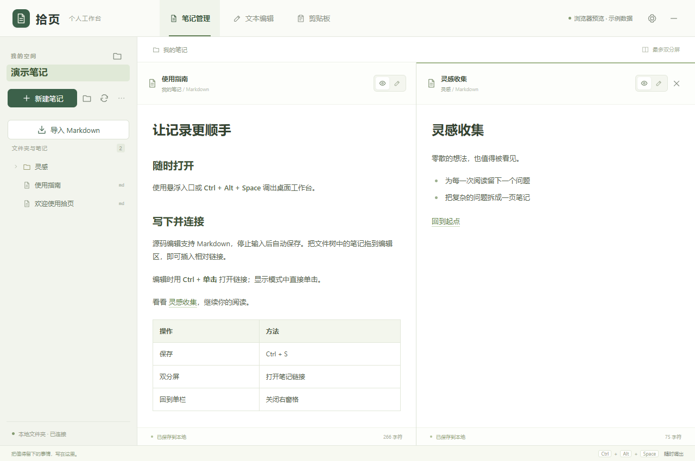

# 拾页 · Workbench

拾页是一款 Windows 本地桌面工作台。你可以用 Markdown 写项目笔记，沿着链接在旁边查阅另一篇笔记，也可以在同一窗口打开日志、源码和配置文件。笔记保存在你选择的文件夹里，可以直接用其他编辑器打开。



## 用拾页做什么

| 模块 | 用法 |
| --- | --- |
| 笔记管理 | 选择一个文件夹作为笔记库，新建或导入 `.md` 文件。将文件树中的笔记拖入正文即可插入相对链接，打开链接后两篇笔记并排显示。停止输入约半秒后自动保存。 |
| 文本编辑 | 将日志拖入窗口，或在资源管理器中右键选择「打开方式 → 拾页」。支持 UTF-8、GBK 等编码、查找替换、选区标注和双视图。重复打开文件会回到已有标签并保留草稿，按 `Ctrl+S` 写回原文件。 |
| 剪贴板 | 查看和刷新系统剪贴板中的当前文本。长文本可以分页阅读，离开模块后释放本次读取的内容。 |

默认按 **Ctrl+Alt+Space** 显示或隐藏工作台，也可以点击悬浮入口或托盘图标。关闭主窗口后拾页会驻留后台，选择「设置 → 退出拾页」可完全退出。

## 在 Windows 上运行

项目已在 Windows 11 x64 上验证。使用安装包时，双击 `拾页_0.1.0_x64-setup.exe` 即可安装到当前用户。桌面版依赖 Microsoft Edge WebView2 Runtime，安装程序会在缺少运行环境时联网下载。

### 从源码启动

准备 Node.js 22.12 或更高版本、Rust MSVC 工具链、Visual Studio C++ Build Tools、Windows SDK 和 WebView2。在 PowerShell 中运行以下命令。

```powershell
git clone https://github.com/beGoodAtYourself/Workbench.git
cd Workbench
npm ci
npm run desktop
```

如果想先看界面，在项目目录运行 `npm run dev`，打开终端显示的本地地址。浏览器演示使用独立的示例笔记。

### 构建安装包

```powershell
npm run package
```

构建成功后，可执行文件位于 `src-tauri/target/release/shiye.exe`，Windows 安装包位于 `src-tauri/target/release/bundle/nsis/`。

## 开发与文档

桌面宿主使用 Tauri 2 和 Rust，界面使用 TypeScript、Vite 和 CodeMirror 6。

```powershell
npm run check
npm test
npm run test:e2e
cargo test --locked --manifest-path src-tauri/Cargo.toml
```

- 查看编辑快捷键、编码转换、草稿恢复和历次版本记录。[使用手册](docs/usage.md)
- 了解笔记、桌面入口和资源限制的行为约定。[项目规格](openspec/specs)
- 查阅已完成的测试和仍待验证的项目。[Windows 验收记录](docs/verification/README.md)
